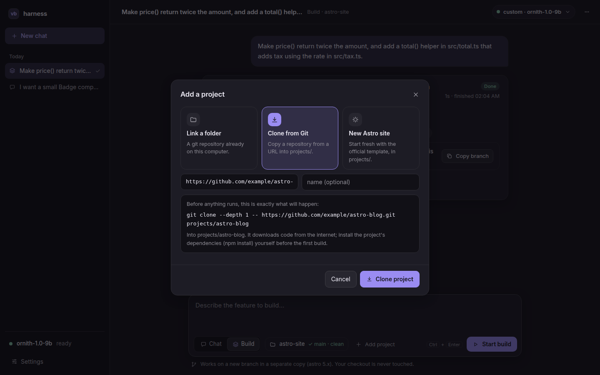

<!-- Generated by scripts/import.mjs from README.md in the harness repository. Edit it there. -->

In the app, Build mode works on **projects**. **Add project** (next to the project picker under the text box, or on
the start page) offers three ways:

- **Link an existing folder.** Paste its full path once. The harness checks it is the top folder of a git
  repository and shows its branch, whether it is clean, and the detected stack and version, or exactly what is
  wrong. Linked folders are stored by name in your `config.json`.
- **Clone from a git URL.** A shallow clone of an `https://` URL into `projects/<name>`.
- **New Astro project.** `npm create astro@latest` into `projects/<name>`, then a first commit.

Clone and New Astro project download code, so the dialog first shows you the exact command and runs it only after
you choose **Clone project** or **Create project**. The app never lists folders on your disk.



Every run works in its own worktree under `workspaces/<runId>` in the harness's home, on branch `harness/<runId>`.
Folders listed in the stack's `dependencyDirs` (for Astro, `node_modules`) are mirrored into the worktree with hard
links, so your project's tools can run there without reinstalling. The harness never writes to them, and every file it
writes replaces the link instead of writing through it.

To keep the result, merge the branch in your repository:

```bash
git merge harness/RUN_ID
```
