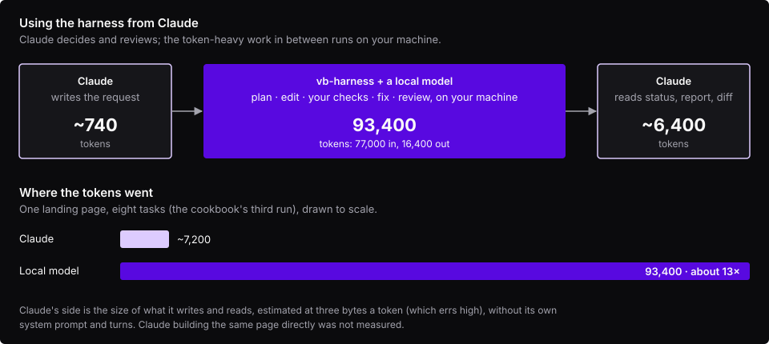

<!-- Generated by scripts/import.mjs from README.md in the harness repository. Edit it there. -->

Claude Code is good at deciding what to build and at reviewing it; the typing in between is where most of its
tokens go. The harness can take that part. Claude writes the request, starts a run, and reads back a short report
and a diff, while a model on your own machine does the planning, editing, fixing and reviewing in between.



**What it saves, measured on the cookbook's third run** (eight tasks, a full landing page):

| | Tokens |
| --- | --- |
| The local model, all of its calls | 93,400 (77,000 in, 16,400 out) |
| Claude: writing the request | ~740 |
| Claude: reading `harness status --json` | ~2,000 |
| Claude: reading the report | ~1,300 |
| Claude: reading the diff (375 lines) | ~3,100 |
| **Claude, in all** | **~7,200** |

About 13 times the model traffic stayed on the local machine. Claude's figures are the sizes of what it would
read and write, estimated the way the harness budgets context (three bytes a token, which errs high); they leave out
Claude's own system prompt and turns. We
have not measured Claude building the same page directly, so this is not a claim about how much that would cost;
it would at least read the files, write the 375 lines and check them, with every turn re-sending the conversation.

The trade is time. A 16K local model one request at a time took a couple of hours for that page. Hand the harness
the work that is clear and self-contained, and keep Claude for the parts that need judgment.

**How to set it up.** Install the harness and connect a local model (see [Install](/start/install/#install) and
[Choosing and checking a model](/guides/choosing-a-model/)). Then tell Claude Code how to delegate, in your
project's `CLAUDE.md`:

```markdown
## Delegating to vb-harness

For a self-contained feature (a component, a page, a small refactor), delegate to the local harness instead of
writing the code yourself:

1. Write the request to `.harness/request.md`: exact file paths, exact values (colours, sizes, text), what each
   file imports, and what is out of scope. The harness keeps what the request says and nothing else.
2. Run it in the background: `ruby <harness>/exe/harness run --repo . --request .harness/request.md --json`.
3. Check on it with `ruby <harness>/exe/harness status RUN_ID --json` rather than polling often; runs take
   minutes to hours.
4. Exit code 3 means the planner asked questions: answer with `harness answer RUN_ID --answers answers.json`.
5. When it finishes, read `runs/RUN_ID/report.md` and `git diff main...harness/RUN_ID`. Gates prove the code
   builds, not that it matches the request, so review it. Merge with `git merge harness/RUN_ID`, or send a
   smaller follow-up request.
```

Any command works the same from Claude's side: `--json` on every command gives machine-readable output, progress
goes to stderr, and the exit code says how the run ended (see [Quick start: the command line](/start/the-command-line/)).
