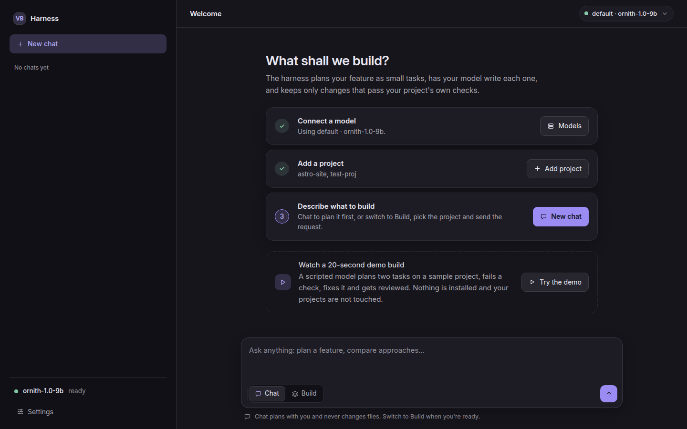
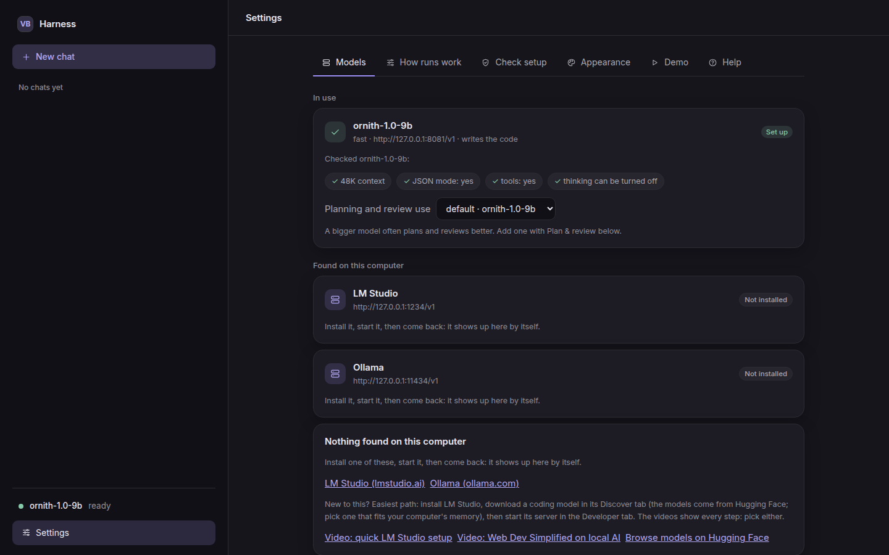
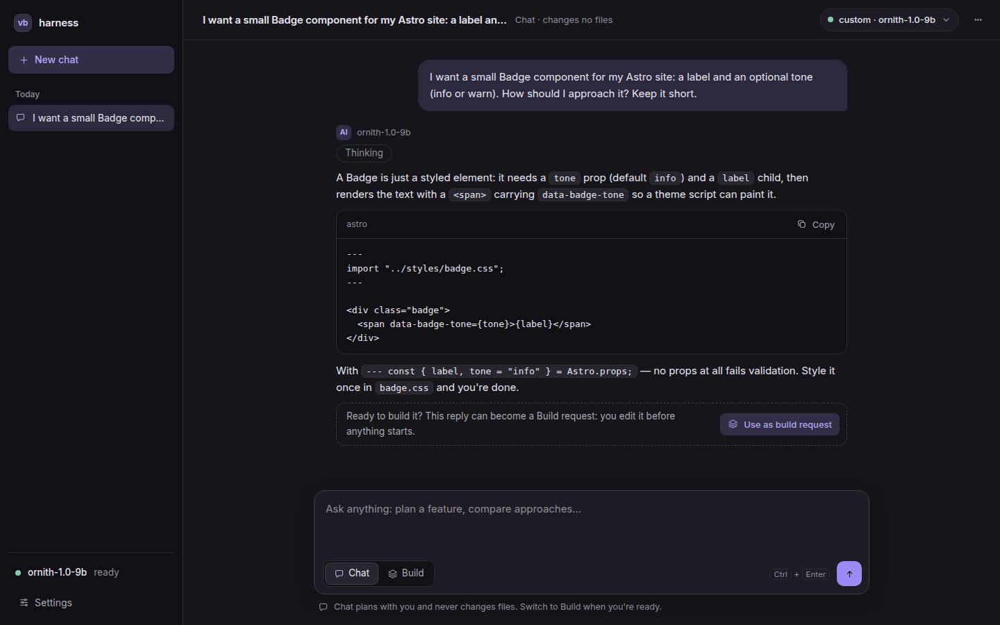
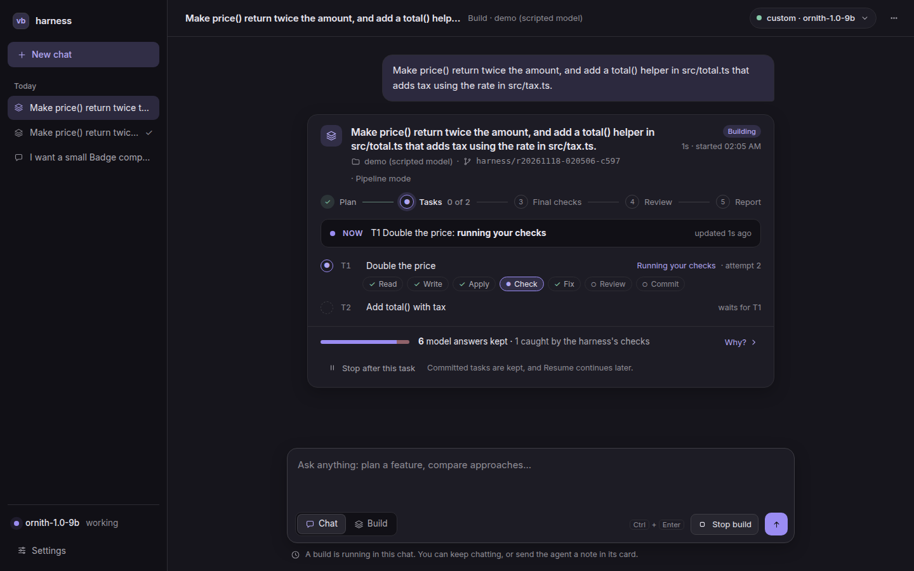
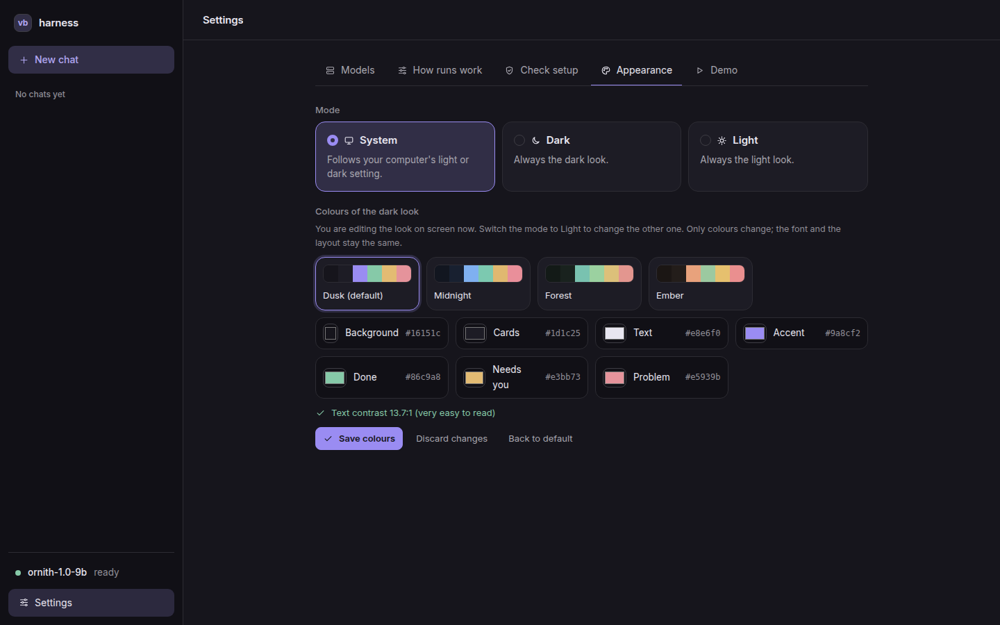
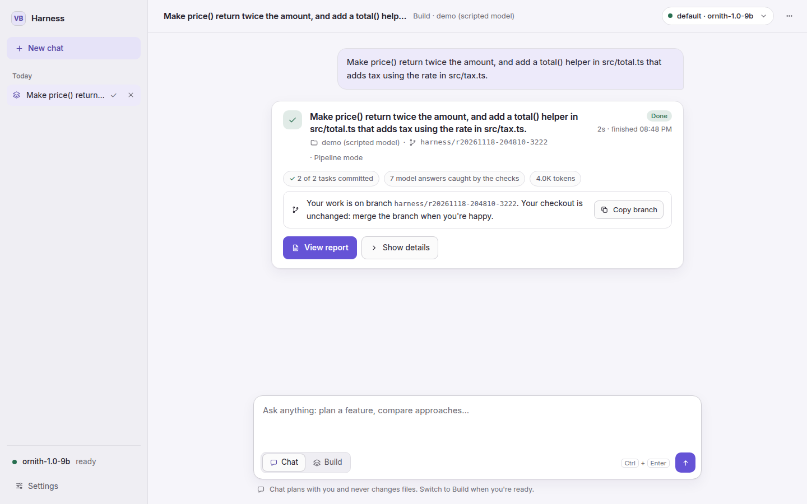

<!-- Generated by scripts/import.mjs from README.md in the harness repository. Edit it there. -->

```bash
ruby exe/harness
```

This starts the local app on `http://127.0.0.1:4567/` and, on first start, opens your browser on the start page.
The sidebar lists your chats, newest first; a chat that started a build shows its state there (**Building**,
**Needs you**, **Failed**, **Stopped** or ✓), so a waiting build is easy to spot. The model in use and whether it is
working sit at the bottom of the sidebar, next to **Settings**.



1. **Connect a model (Settings → Models).** The app looks for LM Studio and Ollama on this machine. You can start
   LM Studio's server, load a downloaded model, or pull an Ollama model, each with one click. For any other server,
   enter its OpenAI-compatible URL under **Another server** and, if it needs a key, the *name* of the environment
   variable that holds the key (never the key itself). Choose **Use** on a model: the harness probes it and shows
   what it found as plain labels, for example "48K context · JSON mode: yes · tools: yes · thinking can be turned
   off". **Plan & review** on any model makes it the model the planner, reviewer and verifier use, even on the same
   server as the first. **Settings → How runs work** picks the [mode](/guides/configuration/) (Careful, Balanced or Quick)
   and the way of working (Pipeline or Agent).

   
2. **Chat.** Chat mode is a planning conversation: work out what to build, compare approaches, sketch the steps.
   Ctrl+Enter (⌘+Enter on macOS) sends; Enter adds a line. Replies stream. When the model thinks first, you see
   **Thinking… 4s** with its latest line of thought as it works; afterwards it folds into **Thought for 12s** above
   the reply, and a click opens the whole thought process so you can judge how it got there. Chat changes no files. **Use as build request** under a reply copies it into the text box in
   Build mode, for you to edit and send: nothing starts until you do.

   
3. **Build.** Switch the text box to **Build**, pick a project (or **Add project**), describe the feature, and choose
   **Start build**. The line under the text box says what will happen, or what stops the build (uncommitted changes,
   a project with a problem). A live card in the chat shows the run:
   - a progress bar, **Plan → Tasks → Final checks → Review → Report**;
   - a **Now** line in plain words ("T1 Double the price: running your checks") with how long ago it last moved, so a
     model that is still writing a long answer is not mistaken for a hang;
   - every task with its state, its commit, and for the active one its steps (Read, Write, Apply, Check, Fix, Review,
     Commit);
   - how many model answers were kept and how many the harness's checks caught. **Why?** lists the reasons in plain
     words; catching bad output is the harness doing its job, and none of it reaches your code;
   - in agent mode, a box to send the agent a note, and **Stop after this task**.

   If the planner has blocking questions, the card turns amber and asks them in the card itself, one field per
   question, with **Answer and continue**. When the run ends, the card shows a short summary, the branch with
   **Copy branch**, and **View report**, which opens the report beside the chat. A stopped or failed run has
   **Resume**, which continues where it left off and keeps what was committed.

   

The app only listens on `127.0.0.1`, refuses other host names, and needs a per-start token for every change.

### Appearance

**Settings → Appearance** chooses the look: **System** (follows your computer's light or dark setting), **Dark** or
**Light**. Each look has a few colour presets, and you can pick your own colours for the background, cards, text,
accent and the three status colours. The app shows the text contrast as you go and warns when it gets hard to read.
Only colours change; the font and layout stay the same. The choice is saved in `appearance.json` next to
`config.json`.




