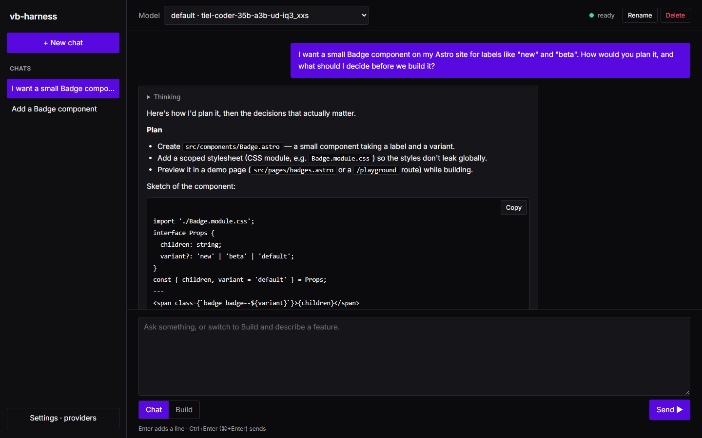
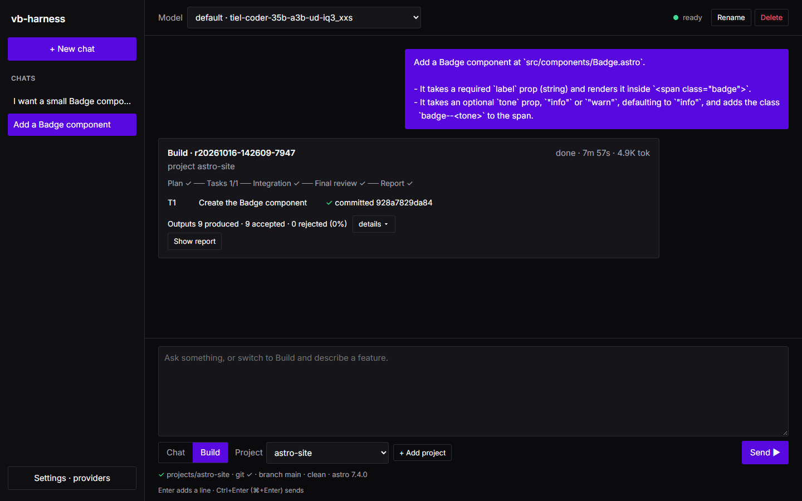

<!-- Generated by scripts/import.mjs from README.md in the harness repository. Edit it there. -->

```bash
ruby exe/harness
```

This starts the local app on `http://127.0.0.1:4567/` and, on first start, opens your browser.

1. **Connect a model (Settings · providers).** The app looks for LM Studio and Ollama on this machine. You can
   start LM Studio's server, load a downloaded model, or pull an Ollama model, each with one click. For any other
   server, enter its OpenAI-compatible URL and, if it needs a key, the *name* of the environment variable that holds
   the key (never the key itself). Choose **Use** on a model: the harness probes it and tells you what it found, for
   example "16K context, JSON mode: yes, tools: no, thinking can be turned off".

   
2. **Chat.** Chat mode is a planning conversation: work out what to build, compare approaches, sketch the steps.
   Ctrl+Enter (⌘+Enter on macOS) sends; Enter adds a line. Replies stream, and thinking text sits in a collapsed
   block. Chat changes no files.

   
3. **Build.** Switch to Build, pick a project (or **+ Add project**), describe the feature, and send. A live card
   shows where the run is, how many model outputs were thrown away and why. If the planner asks a blocking
   question, the card turns purple: answer in the text box, one answer per line. When the run ends, **Show report**
   opens the report.

   

The app only listens on `127.0.0.1`, refuses other host names, and needs a per-start token for every change.
